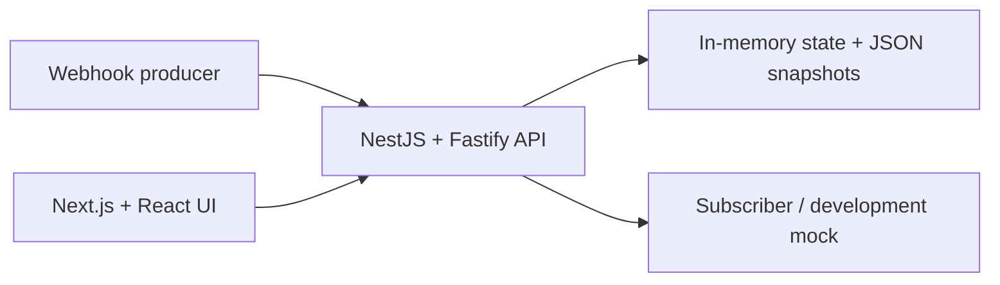

<div align="center">

# Webhook Hub

**English** · [Русский — full technical guide](README.md)

**Receive webhooks. Inspect delivery history. Retry deliberately.**

TypeScript · NestJS / Fastify · Next.js / React

</div>

---

A fullstack webhook-delivery demonstration with an API, a web interface and a mock subscriber. It shows the complete path from accepting an event to recording delivery attempts and inspecting the result in the browser.

**Scope:** a single-process demo with JSON-file persistence, not a distributed production message broker.

## What it demonstrates

- Webhook ingestion with optional source secrets and source-scoped idempotency keys.
- An asynchronous delivery flow: the API accepts an event before contacting the subscriber.
- HMAC-SHA256 signatures for outgoing requests when a source secret is configured.
- Delivery history, status/source filters, event details and a manual retry action.
- DTO validation, Swagger documentation, health checks and a consistent error format.
- A Next.js interface combining server-rendered event data with a client-side retry action.

## Architecture



The API separates sources, incoming webhooks, events, delivery and persistence into modules. State is held in memory and saved through a sequential snapshot-write queue using a temporary file and atomic rename.

## Run locally

Use Node.js and npm. The default ports are 3000, 4002 and 5001.

```sh
npm ci
cp .env.example .env
npm run dev
```

The command starts the API, web UI and mock subscriber together.

| Component | Local address |
| :--- | :--- |
| Web UI | `http://localhost:3000` |
| API | `http://localhost:4002` |
| Swagger | `http://localhost:4002/docs` |
| Mock subscriber | `http://localhost:5001/deliver` |

## Checks

The root [`package.json`](package.json) exposes:

```sh
npm run lint
npm run build
npm test
# Or run the complete sequence:
npm run ci
```

`npm test` runs the API end-to-end suite. These are commands for the repository's checks, not a report of a new test run.

## Behaviour worth knowing

**Retries:** a delivery series has at most three attempts: immediately, then after 1 second, then after another 3 seconds. An attempt has a 5-second timeout. A manual retry starts another series while retaining earlier attempt history.

**Idempotency:** keys are scoped to a source and held in process memory. They are not restored after an API restart. Do not treat this as durable exactly-once processing.

**Persistence:** sources and events are loaded from JSON files on startup. `DATA_DIR` names a directory. The design is intentionally single-process; do not interpret the file store as a multi-node coordination mechanism.

**Sensitive data:** source secrets are not returned by the public API. Stored request headers use a whitelist, and the incoming webhook-secret value is redacted.

See the [Russian technical guide](README.md) for endpoint examples, sequence diagrams, configuration and the detailed behaviour contract.

---

[Igor Kramar](https://github.com/IgorKramar) · Fullstack engineering
